# CyberShield

**Check first. Click with confidence.** A privacy-first Android app that helps people in India spot UPI fraud, phishing SMS, fake KYC messages, malicious links and fraudulent QR codes, in English, Hindi and Marathi.

[](https://github.com/RajvardhanPatil07/CyberShield/actions/workflows/android-build.yml)

## The problem

Payment fraud in India reaches people through the channels they trust: SMS, WhatsApp and UPI QR codes. The scripts repeat: "your account will be blocked, update KYC", "electricity will be cut tonight", "enter your PIN to receive cashback", "this is CBI, you are under digital arrest". Victims are often first-time smartphone users who read Hindi or Marathi more easily than English. Many safety tools need invasive permissions or upload private messages.

## The solution

CyberShield answers "is this a scam?" before you act. It runs on the phone by default and explains why, in your language.

| Feature | What it does |
|---|---|
| **ScamLens** | Analyses pasted or shared messages for 20+ scam patterns (OTP/UPI-PIN/card requests, receive-money tricks, KYC, account and electricity threats, rewards, refunds, loans, task jobs, investment lures, fees, digital-arrest impersonation, AnyDesk/APK installs, secrecy). Highlights the exact phrases, scores 0–100, and lists safe next steps (1930 helpline, Chakshu reporting). Does not flag genuine "do not share your OTP" bank SMS. |
| **Screenshot check** | Pick or share a screenshot; on-device OCR (Latin + Devanagari) reads it and ScamLens analyses it. |
| **LinkGuard** | Inspects a link without opening it: brand impersonation (`hdfcbank-kyc.xyz`), misspellings (`icicbank.com`, `paytrn.com`), Cyrillic homographs, punycode, IP hosts, user-info tricks, shorteners, free-hosting pages, abused TLDs, APK downloads, embedded redirects. |
| **QRGuard** | Live camera or image QR scanning. Decodes UPI requests (payee, name, amount, note), flags collect requests, impersonating payee names, refund/prize notes, large amounts and odd handles, and reminds you that **a PIN is only needed to send money**. |
| **Threat intelligence** (optional) | One tap checks a link with Google Safe Browsing, VirusTotal and URLhaus through the CyberShield backend. Only a provider match is shown as **"Confirmed malicious"**; everything else is labelled a heuristic. |
| **AI explanation** (optional) | One tap sends **redacted** text (numbers, e-mails, UPI IDs removed, previewed first) to Gemini through the backend for a plain-language explanation in the app language. |
| **On-device AI assist** (experimental, off by default) | A small model bundled in the app (204 KB, about 2 ms per message, never online) can raise the risk of a message whose wording looks like a scam even when no rule matches. It can never lower a rule's verdict, and says when it raised one. Turn it on in *Settings*. Design and results: [docs/AI_ML_PLAN.md](docs/AI_ML_PLAN.md). |
| **Help improve detection** (optional) | For a risky result, one tap donates the **redacted** message (previewed first) to the backend's training data, if the backend has donations turned on. |
| **History and dashboard** | Totals, suspicious and high-risk counts, recent activity, search and filters. Never stores message text, full links, UPI IDs or numbers. |
| **Report this** | For risky results, drafts a report on the phone (OTPs and your card, account and Aadhaar numbers removed; the sender's number, UPI ID and links kept) to copy or share, with one-tap Chakshu, cybercrime.gov.in and 1930. Nothing is sent by CyberShield. |
| **Share-to-scan** | Share text or images from any app, use *Check with CyberShield* in the text-selection menu, or launcher shortcuts. |
| **Languages** | English, हिन्दी, मराठी interface and explanations, switchable in-app; detection always uses all three dictionaries plus romanised Hindi. |

Nothing opens automatically. Links and UPI payments open only after a confirmation dialog, with an extra acknowledgement for high-risk results. CyberShield never initiates payments.

## Screenshots

Screenshots are from the debug build on an Android 15 (API 35) emulator. The first row shows the current Cobalt Silk design (5 Nov 2026); the rows below it were taken before the redesign and show the same features in the older look.

| Home | Result, main step first | Report this | QRGuard |
|---|---|---|---|
| 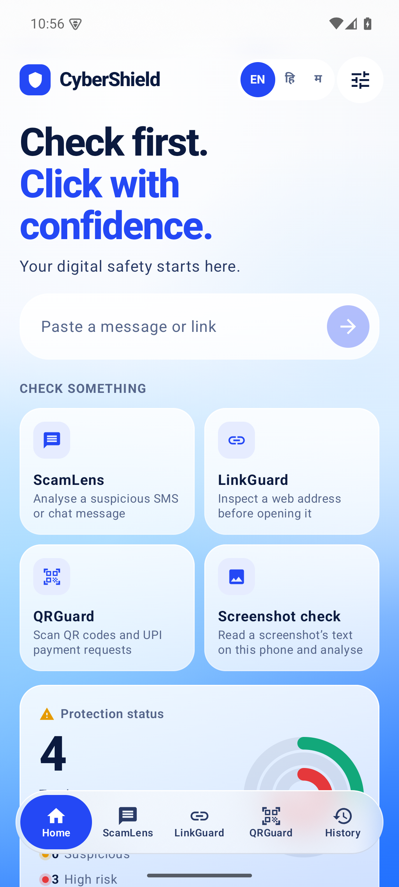 | 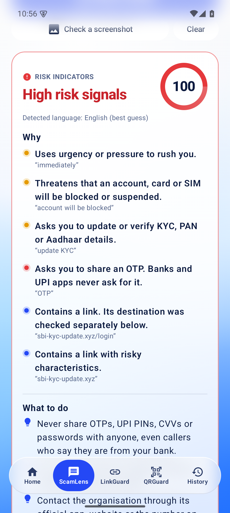 |  | 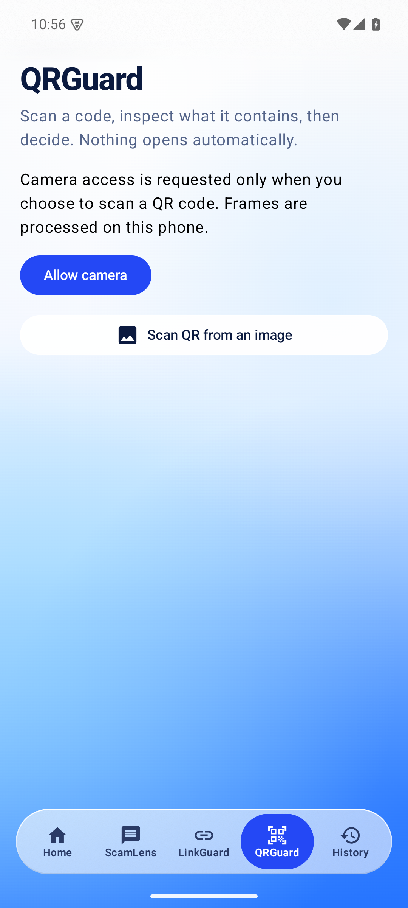 |

| Dashboard | ScamLens | Screenshot OCR (Hindi + English) | QRGuard UPI |
|---|---|---|---|
| 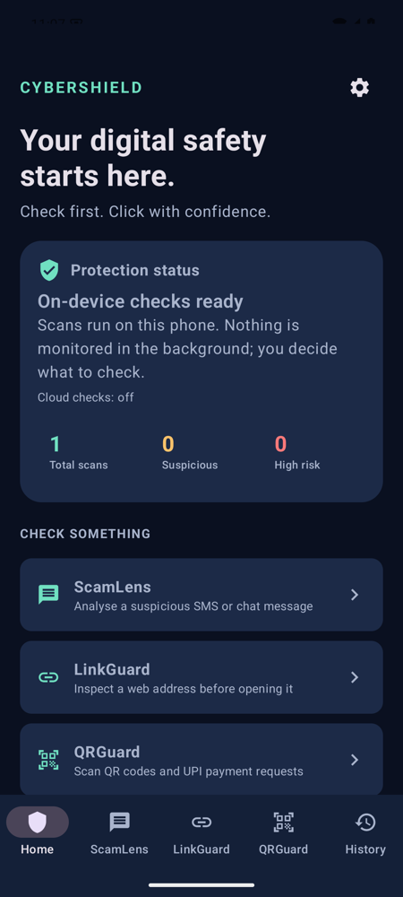 | 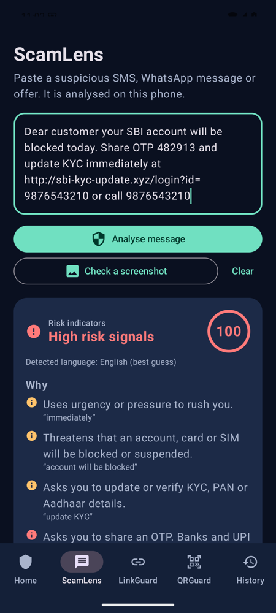 | 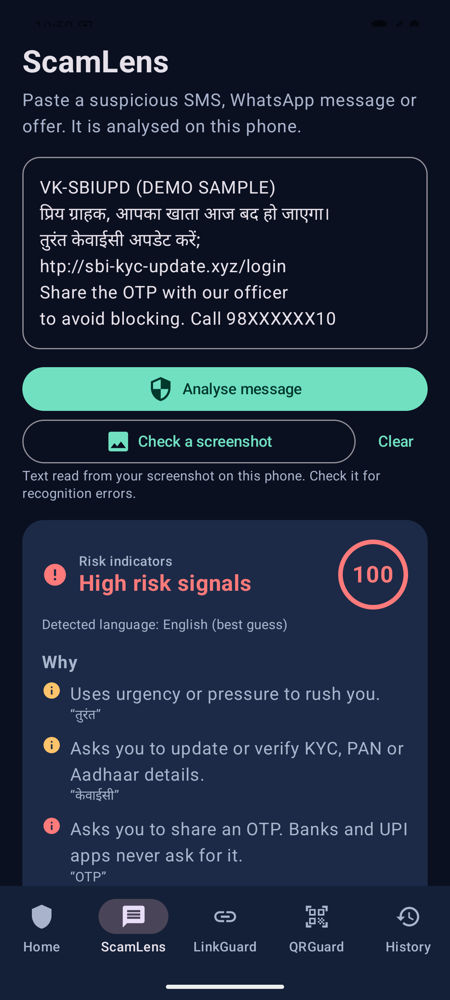 | 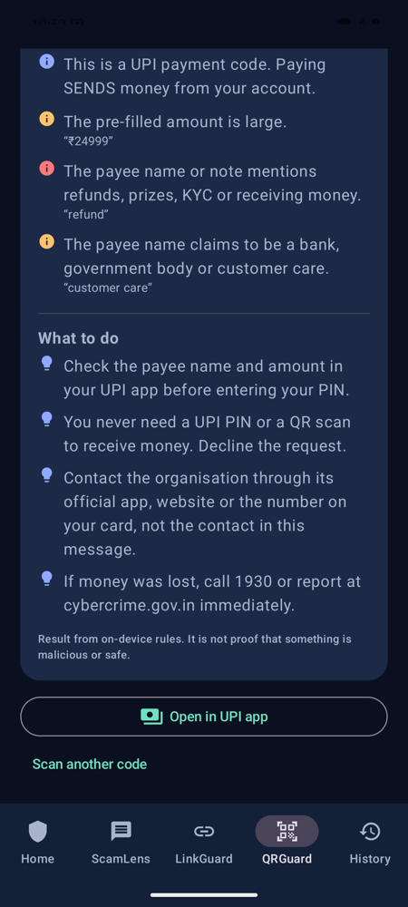 |

| LinkGuard | Open confirmation | Hindi UI | Marathi result |
|---|---|---|---|
| 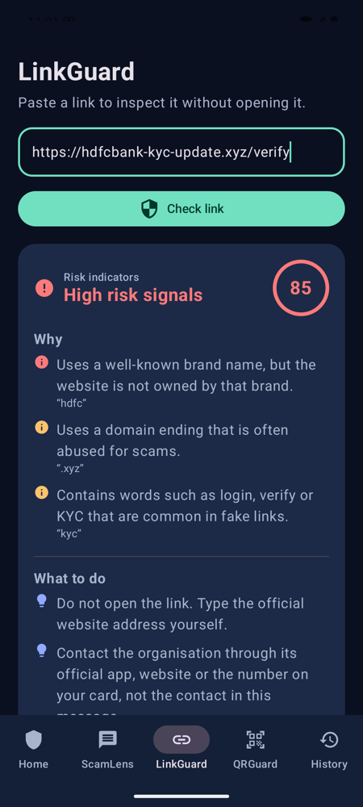 | 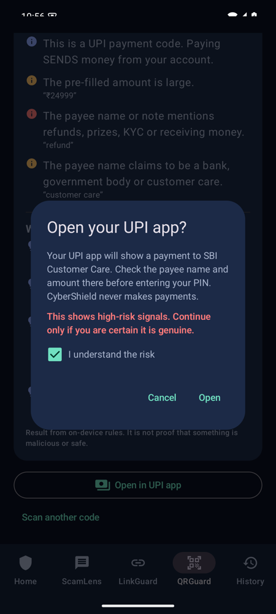 | 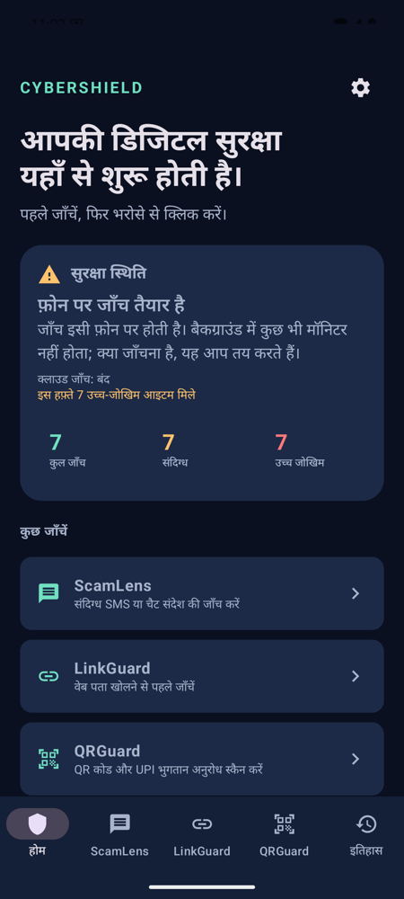 | 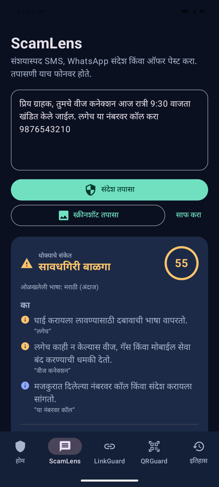 |

| History | AI consent with redaction | Threat intel ⚠️ scripted | AI output ⚠️ scripted |
|---|---|---|---|
| 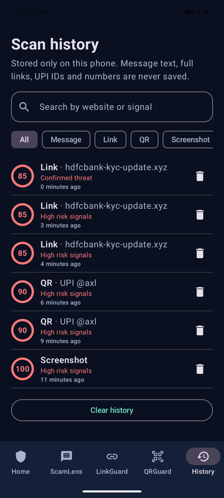 | 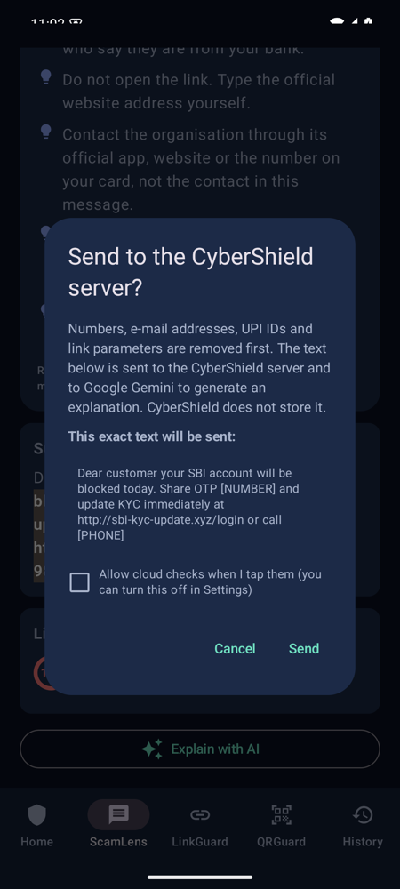 | 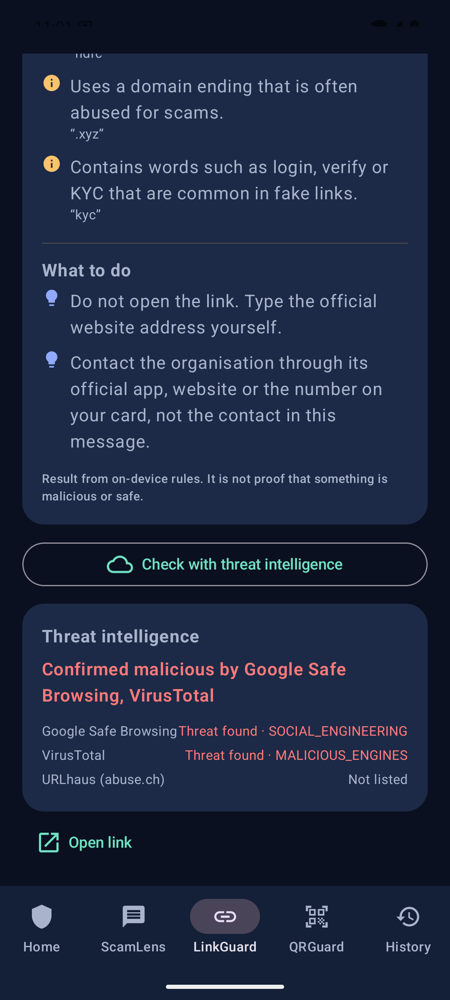 | 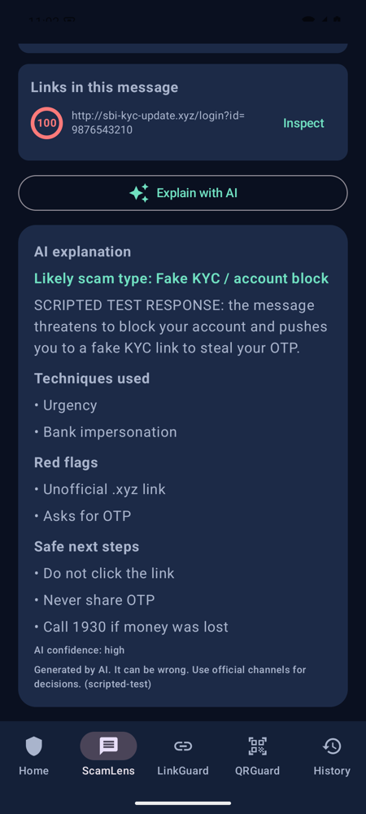 |

⚠️ The last two screenshots were rendered by the real app and the real backend code, but with **scripted provider responses** (no API keys were available). They show how results are displayed, not a live verdict. The AI text itself says "SCRIPTED TEST RESPONSE".

## Architecture

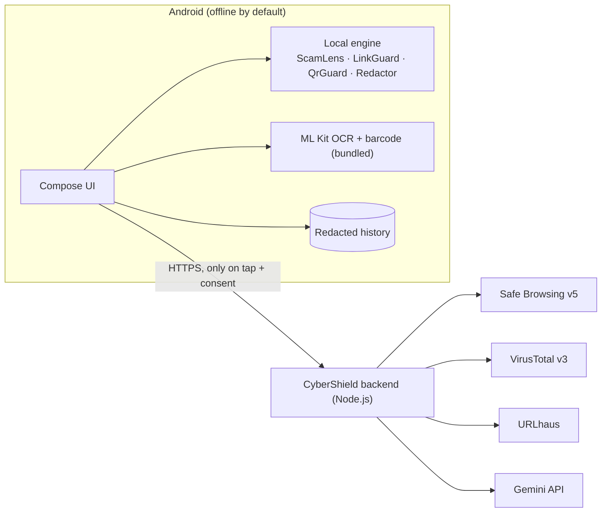

API keys live only in the backend's environment. More diagrams (feature flow, detection workflow, backend pipeline) are in [docs/ARCHITECTURE.md](docs/ARCHITECTURE.md).

## Technology

- **Android:** Kotlin 2.0, Jetpack Compose + Material 3, CameraX 1.4, ML Kit barcode scanning and Devanagari/Latin text recognition (bundled models), AppCompat per-app locales, AGP 8.7, compile/target SDK 35, min SDK 26 (Android 8.0).
- **Backend:** Node.js ≥ 22.9 with **no npm dependencies**; Google Safe Browsing v5, VirusTotal v3, abuse.ch URLhaus, Gemini API with JSON-schema output.
- **CI:** GitHub Actions: wrapper validation, backend tests, web demo parity tests, unit tests, lint, debug and release APKs, artifacts.

## Install the app

Download `cybershield-debug-apk` from the [latest successful CI run](https://github.com/RajvardhanPatil07/CyberShield/actions/workflows/android-build.yml?query=branch%3Amain+is%3Asuccess), unzip, and install `app-arm64-v8a-debug.apk` (most phones, ~38 MB) or `app-universal-debug.apk` (any device). See [docs/DEMO.md](docs/DEMO.md) for a demo script and sample inputs.

## Web demo

[`web/`](web/README.md) is a browser version of ScamLens, LinkGuard and QRGuard for demos, in English, Hindi and Marathi. It is a static site with no build step. Its detection engine is a JavaScript port of the Kotlin one, and a test checks they agree exactly on 383 cases. Run it with `cd web && npm run serve`; deploy steps for Vercel (site) and Render (backend, via `render.yaml`) are in [web/README.md](web/README.md).

## Build from source

Requirements: JDK 17+ and Android SDK Platform 35 (Android Studio provides both). The Gradle wrapper (8.11.1, checksum-pinned) downloads Gradle.

```bash
cd android
./gradlew :app:testDebugUnitTest      # 81 JVM unit tests, including the accuracy evaluation
./gradlew :app:lintDebug              # Android lint (0 issues)
./gradlew :app:assembleDebug          # app/build/outputs/apk/debug/*.apk
./gradlew :app:assembleRelease        # R8-shrunk; unsigned unless signing env vars are set
./gradlew :app:connectedDebugAndroidTest   # 13 UI/OCR/ML tests, needs a device or emulator
```

The commands in the original brief (`gradle --no-daemon -p android …`) also work with a locally installed Gradle 8.9+.

Release signing and GitHub secrets: [docs/RELEASE.md](docs/RELEASE.md).

## Backend and API setup

```bash
cd backend
cp .env.example .env     # every key is optional
npm test                 # 29 tests, no network needed
npm start                # http://localhost:8787
```

The debug app talks to `http://10.0.2.2:8787` (emulator → host). On a physical phone use `adb reverse tcp:8787 tcp:8787` and set *Settings → Server address* to `http://127.0.0.1:8787`. Release builds accept HTTPS only: `CYBERSHIELD_BACKEND_URL=https://… ./gradlew :app:assembleRelease`.

| Variable | Provider | Free tier / terms |
|---|---|---|
| `GOOGLE_SAFE_BROWSING_API_KEY` | Google Safe Browsing v5 | Free, non-commercial only |
| `VIRUSTOTAL_API_KEY` | VirusTotal v3 | 4 req/min, 500/day, non-commercial |
| `URLHAUS_AUTH_KEY` | abuse.ch URLhaus | Free Auth-Key |
| `GEMINI_API_KEY`, `GEMINI_MODEL` | Google Gemini API | Free tier with rate limits; paid per token |

How to get each key, response formats, limits and deployment: [backend/README.md](backend/README.md). PhishTank (closed to new registrations) and OpenPhish (personal/academic licence) were evaluated and not used.

## Testing

| Suite | Count | Covers |
|---|---|---|
| Android JVM unit tests | 81 | Accuracy on the labelled evaluation sets (see below), message scams (EN/HI/MR/Hinglish), genuine OTP and everyday SMS, URLs (IP, punycode, homograph, credentials, lookalikes, shorteners, free hosting, redirects, malformed input), QR and UPI parsing, redaction (cloud and report), history privacy and limits, backend-client failure modes, translation completeness, ML fusion rules, Kotlin↔Python model parity, rules vs rules+ML accuracy and latency |
| Android instrumented tests | 13 | Message → HIGH and history without content; LinkGuard confirmation gating; genuine OTP → LOW; clear history; share text, share link, `PROCESS_TEXT`; on-device OCR of a Hindi+English screenshot; QR decoding from images; ML model loads from the APK, is off by default, raises a missed scam once switched on, and a donation reaches a local backend |
| Backend tests | 29 | Valid request, invalid input (400/413/415), missing credentials, provider down, retry, cache, rate limits (app and VirusTotal), shortener expansion without SSRF, AI schema validation and error mapping, donations (stored, unredacted text rejected, bad label, not configured) |
| ML pipeline self-tests (`cd ml && make test`) | 8 | Config and data loading, label taxonomy matches `FindingCode`, feature hashing, training, calibration, donation ingestion and the frozen holdout split |

### Accuracy

`EvaluationTest` scores the on-device engines on labelled dev and holdout sets of messages, links and QR codes (`android/app/src/test/resources/eval/`). Holdout results (5 Nov 2026), the fairer estimate:

| | Recall | Precision | False alarms |
|---|---|---|---|
| Messages (40 scam, 30 legit) | 80.0% | 100% | 0 |
| Links (15 phishing, 10 legit) | 86.7% | 100% | 0 |
| QR codes (6 scam, 6 legit) | 100% | 100% | 0 |

The samples were written for this project from public advisory patterns. They are not real collected messages, so these numbers do not measure real-world accuracy. Method, before/after figures and the known misses: [docs/EVALUATION.md](docs/EVALUATION.md).

With on-device AI assist switched on, message holdout recall rises from 80.0% to 87.5%, but 2 of the 30 legitimate messages (6.7%) are wrongly flagged. That is why the feature is off by default ([details](docs/AI_ML_PLAN.md)).

## Privacy and security

- On-device by default; cloud calls only on tap, after a consent dialog showing exactly what is sent.
- Permissions: `CAMERA` (QR screen, runtime) and `INTERNET`. No SMS, storage, contacts, location, accessibility or notification access.
- History stores scores, signal names and at most a hostname or UPI handle suffix; excluded from backups; deletable per item or all at once.
- HTTPS-only networking in release builds; no secrets in the APK; backend input validation, rate limits, body caps, timeouts, SSRF-safe link expansion, logs without content.
- Google ML Kit sends its own diagnostic telemetry (device model, app version, per-install ID, performance). Image content is not sent. This is disclosed in the policy.

Details: [PRIVACY.md](PRIVACY.md) · [docs/SECURITY_REVIEW.md](docs/SECURITY_REVIEW.md) · [docs/PLATFORM_LIMITATIONS.md](docs/PLATFORM_LIMITATIONS.md)

## Limitations

- Detection is rule-based by default. On the project's own holdout set it misses 1 in 5 scam messages, mostly familiar tricks in unfamiliar words; it has not been measured on real collected messages. New wording or clean-looking domains can score LOW, and a low score is not proof of safety.
- The experimental AI model was trained on the same synthetic samples, so its real-world accuracy is unknown. It stays off by default until it beats the rules on real, donated messages.
- Threat intelligence and AI are implemented and tested with scripted responses but have **not been run against live API keys**.
- Tested on an Android 15 emulator and on the maintainer's own phone. Wider testing across phone makers and older Android versions has not been done.
- Hindi and Marathi translations have not been reviewed by native speakers; language detection is a best guess. See [docs/MULTILINGUAL.md](docs/MULTILINGUAL.md).
- No background protection: Android does not let ordinary apps read other apps' messages, and CyberShield deliberately avoids notification and accessibility access.
- The backend has no app attestation yet (rate limits only) and keeps limits in memory per instance.
- Release APKs are unsigned until a keystore is configured.

## Roadmap

1. Live-key verification of Safe Browsing, VirusTotal, URLhaus and Gemini; deploy the backend on HTTPS.
2. Collect real, consented, redacted messages through *Help improve detection* (needs a backend with storage that survives restarts), freeze them as an untouched test split, then retrain the on-device model and turn it on by default only if it beats the rules there ([plan](docs/AI_ML_PLAN.md)).
3. Native-speaker review of Hindi and Marathi; more Indian languages.
4. Play Integrity / App Check on the backend.

Done: physical-device check on the maintainer's phone; labelled evaluation with published precision/recall; pre-filled, redacted "Report this" flow for Chakshu, cybercrime.gov.in and 1930; opt-in on-device AI model with a reproducible training pipeline (`ml/`) and a redacted donation loop.

## Project docs

[Architecture](docs/ARCHITECTURE.md) · [Evaluation](docs/EVALUATION.md) · [AI/ML plan and results](docs/AI_ML_PLAN.md) · [Demo script](docs/DEMO.md) · [Pitch](docs/PITCH.md) · [Security review](docs/SECURITY_REVIEW.md) · [Audit of the starting code](docs/AUDIT.md) · [Release & signing](docs/RELEASE.md) · [Multilingual scope](docs/MULTILINGUAL.md) · [Platform limits](docs/PLATFORM_LIMITATIONS.md) · [Privacy policy](PRIVACY.md)

No licence has been selected yet. Choose one after reviewing dependency obligations (ML Kit is subject to Google's ML Kit terms).

If you lost money to fraud, call **1930** or report at **cybercrime.gov.in**.
