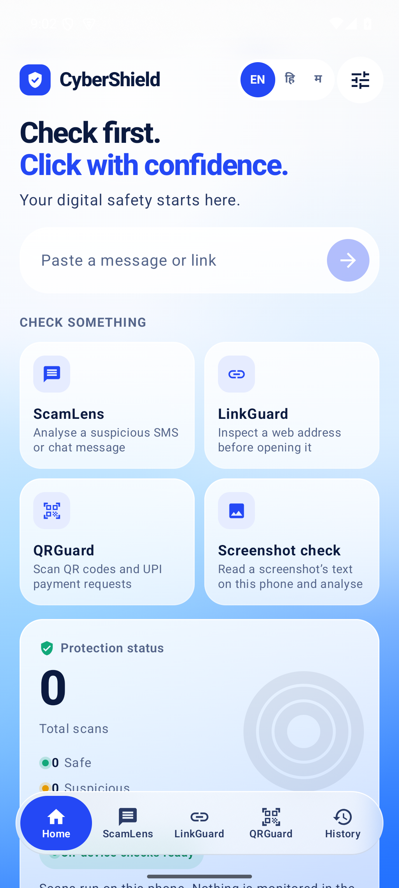
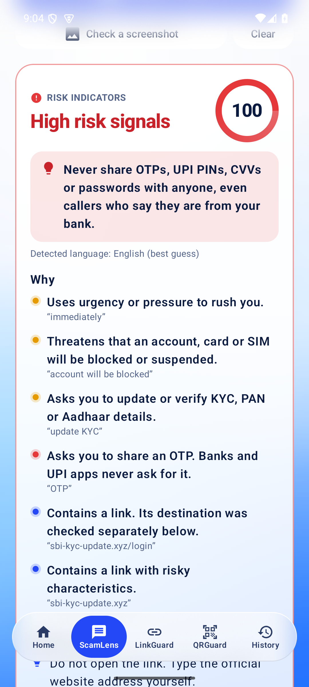
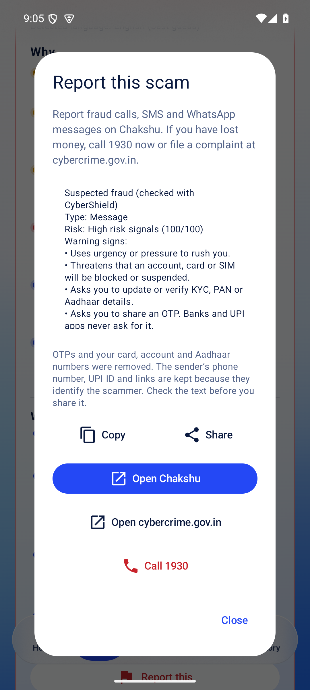
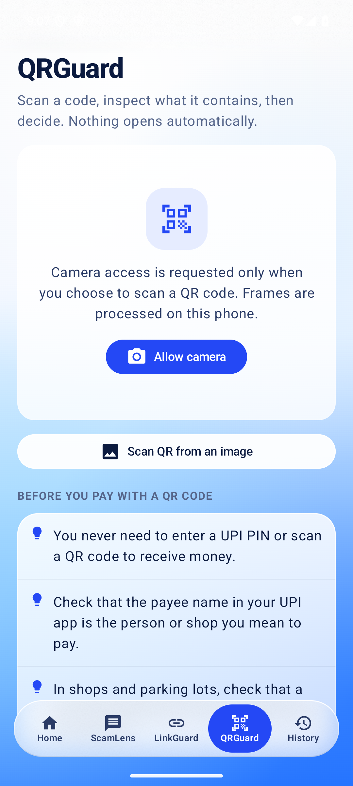
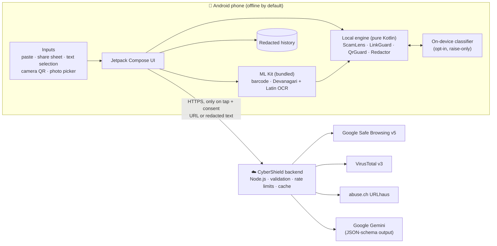
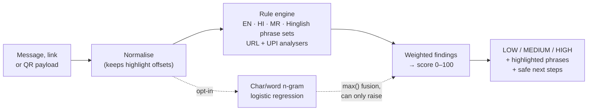

<div align="center">


# CyberShield

**Check first. Click with confidence.**

A privacy-first Android app that tells people in India whether a message, link or QR code is a scam *before* they act on it, in English, हिन्दी and मराठी.

[](https://cybershield-theta-cyan.vercel.app)
[](https://youtu.be/ztQrNjkaHcg)
[](https://github.com/RajvardhanPatil07/CyberShield/releases/latest)

[](https://github.com/RajvardhanPatil07/CyberShield/actions/workflows/android-build.yml)
[](https://github.com/RajvardhanPatil07/CyberShield/actions/workflows/ml-eval.yml)


-3DDC84?logo=android&logoColor=white)

[Live demo](https://cybershield-theta-cyan.vercel.app) · [Demo video](#demo-video) · [Features](#features) · [How it works](#how-it-works) · [Tech stack](#tech-stack) · [Quick start](#quick-start) · [Accuracy](#accuracy) · [Docs](#documentation)

</div>

---

## Why CyberShield

Payment fraud in India arrives through channels people trust: SMS, WhatsApp and UPI QR codes. The scripts repeat: *"update your KYC or your account will be blocked"*, *"electricity will be cut tonight"*, *"enter your PIN to receive cashback"*, *"this is CBI, you are under digital arrest"*. Many victims are first-time smartphone users who read Hindi or Marathi more easily than English, and many safety tools either need invasive permissions or upload private messages.

CyberShield answers one question, **"is this a scam?"**, on the phone, without reading your inbox, and explains the answer in your language.

<table>
<tr>
<td align="center"><b>🔒 Offline by default</b><br><sub>All detection runs on the phone. Cloud checks only on tap, after consent.</sub></td>
<td align="center"><b>🇮🇳 Built for Indian scams</b><br><sub>UPI collect tricks, KYC, digital arrest, <code>.bank.in</code> / <code>.gov.in</code> awareness.</sub></td>
<td align="center"><b>🗣️ Three languages</b><br><sub>English, Hindi, Marathi and romanised Hindi, with Devanagari OCR.</sub></td>
<td align="center"><b>🧾 Explains why</b><br><sub>Highlights the exact phrases and lists safe next steps (1930, Chakshu).</sub></td>
</tr>
</table>

## Try it

| | |
|---|---|
| ▶️ **Demo video** | **[youtu.be/ztQrNjkaHcg](https://youtu.be/ztQrNjkaHcg)**: a walkthrough of the app on YouTube. |
| 🌐 **Web demo** | **[cybershield-theta-cyan.vercel.app](https://cybershield-theta-cyan.vercel.app)**: ScamLens, LinkGuard and QRGuard in the browser, connected to the live backend on Render. |
| 📱 **Android app** | Download from the [latest release](https://github.com/RajvardhanPatil07/CyberShield/releases/latest): `CyberShield-v0.3.0-arm64-v8a.apk` (most phones, ~21 MB) or `CyberShield-v0.3.0-universal.apk` (any device). English, हिन्दी and मराठी. |
| 🧪 **Sample inputs** | Scam messages, links and QR codes to test with: [docs/DEMO.md](docs/DEMO.md) and [docs/demo/](docs/demo/). |

## Demo video

<div align="center">

[](https://youtu.be/ztQrNjkaHcg)

<sub>Click the image to watch on YouTube.</sub>

</div>

## Screenshots

<div align="center">

| Home | Result | Report this | QRGuard |
|:---:|:---:|:---:|:---:|
|  |  |  |  |

<sub>Debug build on an Android 15 (API 35) emulator, Cobalt Silk design (5 Nov 2026).</sub>

</div>

<details>
<summary><b>More screenshots</b> (OCR, LinkGuard, Hindi and Marathi UI, history, AI consent)</summary>
<br>

These were taken before the Cobalt Silk redesign and show the same features in the older look.

| Dashboard | ScamLens | Screenshot OCR (Hindi + English) | QRGuard UPI |
|:---:|:---:|:---:|:---:|
|  |  |  |  |

| LinkGuard | Open confirmation | Hindi UI | Marathi result |
|:---:|:---:|:---:|:---:|
|  |  |  |  |

| History | AI consent with redaction | Threat intel ⚠ scripted | AI output ⚠ scripted |
|:---:|:---:|:---:|:---:|
|  |  |  |  |

⚠ The last two were rendered by the real app and real backend code, but with **scripted provider responses** (no API keys were available at the time). They show how results are displayed, not a live verdict. The AI text itself says "SCRIPTED TEST RESPONSE".

</details>

## Features

### Core checks (on-device, no internet needed)

| Feature | What it does |
|---|---|
| 🔍 **ScamLens** | Analyses pasted or shared messages for 20+ scam patterns: OTP / UPI-PIN / card requests, receive-money tricks, KYC, account and electricity threats, rewards, refunds, loans, task jobs, investment lures, fees, digital-arrest impersonation, AnyDesk / APK installs and secrecy demands. Highlights the exact phrases, scores 0–100 and lists safe next steps. Does **not** flag genuine "do not share your OTP" bank SMS. |
| 🖼️ **Screenshot check** | Pick or share a screenshot; on-device OCR (Latin + Devanagari) reads it and ScamLens analyses the text. |
| 🔗 **LinkGuard** | Inspects a link without opening it: brand impersonation (`hdfcbank-kyc.xyz`), misspellings (`icicbank.com`, `paytrn.com`), Cyrillic homographs, punycode, IP hosts, user-info tricks, shorteners, free-hosting pages, abused TLDs, APK downloads and embedded redirects. |
| 📷 **QRGuard** | Live camera or image QR scanning. Decodes UPI requests (payee, name, amount, note), flags collect requests, impersonating payee names, refund/prize notes, large amounts and odd handles, and reminds you that **a PIN is only needed to send money**. |

### Optional, consent-based cloud layer

| Feature | What it does |
|---|---|
| 🛡️ **Threat intelligence** | One tap checks a link with Google Safe Browsing, VirusTotal and URLhaus through the CyberShield backend. Only a provider match is shown as **"Confirmed malicious"**; everything else is labelled a heuristic. |
| 🤖 **AI explanation** | One tap sends **redacted** text (numbers, e-mails and UPI IDs removed, previewed first) to Gemini through the backend for a plain-language explanation in the app language. |
| 🧠 **On-device AI assist** *(experimental, off by default)* | A 204 KB model bundled in the app (about 2 ms per message, never online) can raise the risk of a message whose wording looks like a scam even when no rule matches. It can never lower a rule's verdict, and says when it raised one. |
| 🤝 **Help improve detection** | For a risky result, one tap donates the **redacted** message (previewed first) to the backend's training data, if donations are enabled on the backend. |

### Everyday tools

| Feature | What it does |
|---|---|
| 📊 **History and dashboard** | Totals, suspicious and high-risk counts, recent activity, search and filters. Never stores message text, full links, UPI IDs or phone numbers. |
| 📝 **Report this** | Drafts a report on the phone (OTPs and your card, account and Aadhaar numbers removed; the sender's number, UPI ID and links kept) to copy or share, with one-tap Chakshu, cybercrime.gov.in and 1930. CyberShield itself sends nothing. |
| 📤 **Share-to-scan** | Share text or images from any app, use *Check with CyberShield* in the text-selection menu, or use launcher shortcuts. |
| 🌐 **Languages** | English, हिन्दी and मराठी interface and explanations, switchable in-app. Detection always uses all three dictionaries plus romanised Hindi. |

> **Nothing opens automatically.** Links and UPI payments open only after a confirmation dialog, with an extra acknowledgement for high-risk results. CyberShield never initiates payments.

## How it works

### System architecture



API keys live only in the backend's environment. The APK contains the backend's public URL and nothing else.

### Detection pipeline



Rules stay the source of the explanation: every warning points at the phrase or URL feature that triggered it. The ML model only adjusts the score, and the UI says when it did. More diagrams (feature flow, detection workflow, backend pipeline) are in [docs/ARCHITECTURE.md](docs/ARCHITECTURE.md).

### Code layout

```text
CyberShield/
├── android/      Kotlin + Compose app
│   └── app/src/main/java/io/cybershield/app/
│       ├── security/   ScamLens, LinkGuard, QrGuard, Redactor, MlFusion (no Android deps, JVM-testable)
│       ├── ml/         On-device classifier (exact Kotlin port of the Python model)
│       ├── vision/     ML Kit OCR and QR decoding from images
│       ├── cloud/      Backend client behind a Transport interface
│       ├── data/       Redacted history and settings
│       └── ui/         Compose screens, dialogs, theme, strings
├── backend/      Dependency-free Node.js proxy for threat intel, AI and donations
├── web/          Static browser demo; JS port of the Kotlin engine
├── ml/           Reproducible training pipeline (Python): data, features, calibration, eval
├── docs/         Architecture, evaluation, security review, demo script, …
└── render.yaml   Render Blueprint for the backend
```

## Tech stack

| Layer | Technology |
|---|---|
| **Android** | Kotlin 2.0, Jetpack Compose + Material 3, CameraX 1.4, ML Kit barcode scanning and Devanagari/Latin text recognition (bundled models), AppCompat per-app locales, AGP 8.7, compile/target SDK 35, min SDK 26 (Android 8.0), R8 shrinking |
| **On-device ML** | Char/word n-gram logistic regression (204 KB JSON asset), trained in Python, ported to Kotlin with a parity test |
| **Backend** | Node.js ≥ 22.9 with **zero npm dependencies**; Google Safe Browsing v5, VirusTotal v3, abuse.ch URLhaus, Gemini API with JSON-schema output; deployed on Render |
| **Web demo** | Static HTML/CSS/JS, no build step, strict Content-Security-Policy; deployed on Vercel |
| **CI** | GitHub Actions: Gradle wrapper validation, backend tests, web/Android parity tests, unit tests, lint, debug and release APKs, ML accuracy evaluation |

## Engineering highlights

- **Same verdict everywhere.** The web engine is a JavaScript port of the Kotlin engine, and a test checks that both agree exactly on 383 cases.
- **Testable core.** The detection engine in `security/` has no Android dependencies, so it runs in plain JVM unit tests.
- **Honest labels.** Heuristic results are labelled as heuristics. "Confirmed malicious" appears only when a threat-intelligence provider lists the URL.
- **Raise-only ML.** The model can increase risk but never hide a rule's warning, and the bundled model's output is checked against the Python reference.
- **Hardened backend.** Input validation, body-size caps, timeouts, per-app and per-provider rate limits, caching, SSRF-safe shortener expansion, and logs that never contain message content.
- **Small footprint.** Two permissions (`CAMERA`, `INTERNET`). No SMS, contacts, storage, location, accessibility or notification access.

## Quick start

### Android app

Requirements: JDK 17+ and Android SDK Platform 35 (Android Studio provides both). The Gradle wrapper (8.11.1, checksum-pinned) downloads Gradle.

```bash
cd android
./gradlew :app:testDebugUnitTest           # 81 JVM unit tests, including the accuracy evaluation
./gradlew :app:lintDebug                   # Android lint (0 issues)
./gradlew :app:assembleDebug               # app/build/outputs/apk/debug/*.apk
./gradlew :app:assembleRelease             # R8-shrunk; unsigned unless signing env vars are set
./gradlew :app:connectedDebugAndroidTest   # 13 UI/OCR/ML tests, needs a device or emulator
```

Release signing and GitHub secrets: [docs/RELEASE.md](docs/RELEASE.md).

### Backend

```bash
cd backend
cp .env.example .env     # every key is optional
npm test                 # 30 tests, no network needed
npm start                # http://localhost:8787
```

The debug app talks to `http://10.0.2.2:8787` (emulator → host). On a physical phone, run `adb reverse tcp:8787 tcp:8787` and set *Settings → Server address* to `http://127.0.0.1:8787`. Release builds accept HTTPS only: `CYBERSHIELD_BACKEND_URL=https://… ./gradlew :app:assembleRelease`.

<details>
<summary><b>API keys</b> (all optional)</summary>
<br>

| Variable | Provider | Free tier / terms |
|---|---|---|
| `GOOGLE_SAFE_BROWSING_API_KEY` | Google Safe Browsing v5 | Free, non-commercial only |
| `VIRUSTOTAL_API_KEY` | VirusTotal v3 | 4 req/min, 500/day, non-commercial |
| `URLHAUS_AUTH_KEY` | abuse.ch URLhaus | Free Auth-Key |
| `GEMINI_API_KEY`, `GEMINI_MODEL` | Google Gemini API | Free tier with rate limits; paid per token |

How to get each key, response formats, limits and deployment: [backend/README.md](backend/README.md). PhishTank (closed to new registrations) and OpenPhish (personal/academic licence) were evaluated and not used.

</details>

### Web demo

```bash
cd web && npm run serve
```

Deploy steps for Vercel (site) and Render (backend, via [`render.yaml`](render.yaml)) are in [web/README.md](web/README.md).

## Testing

| Suite | Tests | Covers |
|---|:---:|---|
| Android JVM unit tests | 81 | Accuracy on labelled evaluation sets; message scams (EN/HI/MR/Hinglish); genuine OTP and everyday SMS; URLs (IP, punycode, homograph, credentials, lookalikes, shorteners, free hosting, redirects, malformed input); QR and UPI parsing; redaction; history privacy; backend-client failure modes; translation completeness; ML fusion; Kotlin↔Python model parity |
| Android instrumented tests | 13 | End-to-end message → HIGH without storing content; LinkGuard confirmation gating; genuine OTP → LOW; share text/link and `PROCESS_TEXT`; on-device OCR of a Hindi + English screenshot; QR decoding from images; ML model loading and donation to a local backend |
| Backend tests | 30 | Valid and invalid input (400/413/415), missing credentials, provider down, retry, cache, rate limits, SSRF-safe shortener expansion, AI schema validation, donations |
| Web demo tests | 7 | Message, URL and QR results match the Kotlin engine exactly (383 cases); every UI string and finding is translated in all three languages |
| ML pipeline self-tests (`cd ml && make test`) | 8 | Config and data loading, label taxonomy matches `FindingCode`, feature hashing, training, calibration, donation ingestion, frozen holdout split |

## Accuracy

`EvaluationTest` scores the on-device engines on labelled dev and holdout sets ([`android/app/src/test/resources/eval/`](android/app/src/test/resources/eval/)). Holdout results (5 Nov 2026):

| Input | Recall | Precision | False alarms |
|---|:---:|:---:|:---:|
| Messages (40 scam, 30 legit) | 80.0% | 100% | 0 |
| Links (15 phishing, 10 legit) | 86.7% | 100% | 0 |
| QR codes (6 scam, 6 legit) | 100% | 100% | 0 |

The samples were written for this project from public advisory patterns. They are not real collected messages, so these numbers do not measure real-world accuracy. With on-device AI assist switched on, message recall rises from 80.0% to 87.5%, but 2 of the 30 legitimate messages (6.7%) are wrongly flagged, which is why the feature is off by default. Method, known misses and ML results: [docs/EVALUATION.md](docs/EVALUATION.md) · [docs/AI_ML_PLAN.md](docs/AI_ML_PLAN.md).

## Privacy and security

- On-device by default; cloud calls only on tap, after a consent dialog that shows exactly what is sent.
- History stores scores, signal names and at most a hostname or UPI handle suffix. It is excluded from backups and can be deleted per item or all at once.
- HTTPS-only networking in release builds and no secrets in the APK.
- Google ML Kit sends its own diagnostic telemetry (device model, app version, per-install ID, performance). Image content is not sent. This is disclosed in the privacy policy.

Details: [PRIVACY.md](PRIVACY.md) · [Security review](docs/SECURITY_REVIEW.md) · [Platform limitations](docs/PLATFORM_LIMITATIONS.md)

## Limitations

<details>
<summary>Known gaps, stated plainly</summary>
<br>

- Detection is rule-based by default. On the project's own holdout set it misses 1 in 5 scam messages, mostly familiar tricks in unfamiliar words; it has not been measured on real collected messages. A low score is not proof of safety.
- The experimental AI model was trained on the same synthetic samples, so its real-world accuracy is unknown. It stays off by default until it beats the rules on real, donated messages.
- The threat-intelligence lookups were tested with scripted provider responses; the live backend does not have Safe Browsing, VirusTotal or URLhaus keys configured yet.
- Tested on an Android 15 emulator and on the maintainer's own phone, not yet across phone makers and older Android versions.
- Hindi and Marathi translations have not been reviewed by native speakers; language detection is a best guess. See [docs/MULTILINGUAL.md](docs/MULTILINGUAL.md).
- No background protection: Android does not let ordinary apps read other apps' messages, and CyberShield deliberately avoids notification and accessibility access.
- The backend has no app attestation yet (rate limits only) and keeps limits in memory per instance.
- Release APKs are unsigned until a keystore is configured.

</details>

## Roadmap

- [x] Labelled evaluation with published precision and recall
- [x] Pre-filled, redacted "Report this" flow for Chakshu, cybercrime.gov.in and 1930
- [x] Opt-in on-device AI model with a reproducible training pipeline and a redacted donation loop
- [x] Physical-device check on the maintainer's phone
- [x] Backend deployed on HTTPS (Render) and a public web demo (Vercel)
- [ ] Live-key verification of Safe Browsing, VirusTotal and URLhaus
- [ ] Collect real, consented, redacted messages; retrain and enable the on-device model only if it beats the rules on them
- [ ] Native-speaker review of Hindi and Marathi; more Indian languages
- [ ] Play Integrity / App Check on the backend

## Documentation

| | |
|---|---|
| **Design** | [Architecture](docs/ARCHITECTURE.md) · [AI/ML plan and results](docs/AI_ML_PLAN.md) · [Multilingual scope](docs/MULTILINGUAL.md) |
| **Quality** | [Evaluation](docs/EVALUATION.md) · [Security review](docs/SECURITY_REVIEW.md) · [Audit of the starting code](docs/AUDIT.md) · [Platform limits](docs/PLATFORM_LIMITATIONS.md) |
| **Using it** | [Demo script](docs/DEMO.md) · [Pitch](docs/PITCH.md) · [Release & signing](docs/RELEASE.md) · [Backend](backend/README.md) · [Web demo](web/README.md) · [ML pipeline](ml/README.md) |
| **Policy** | [Privacy policy](PRIVACY.md) |

No licence has been selected yet. Choose one after reviewing dependency obligations (ML Kit is subject to Google's ML Kit terms).

---

<div align="center">

**Lost money to fraud?** Call **1930** or report at **[cybercrime.gov.in](https://cybercrime.gov.in)**.

</div>
