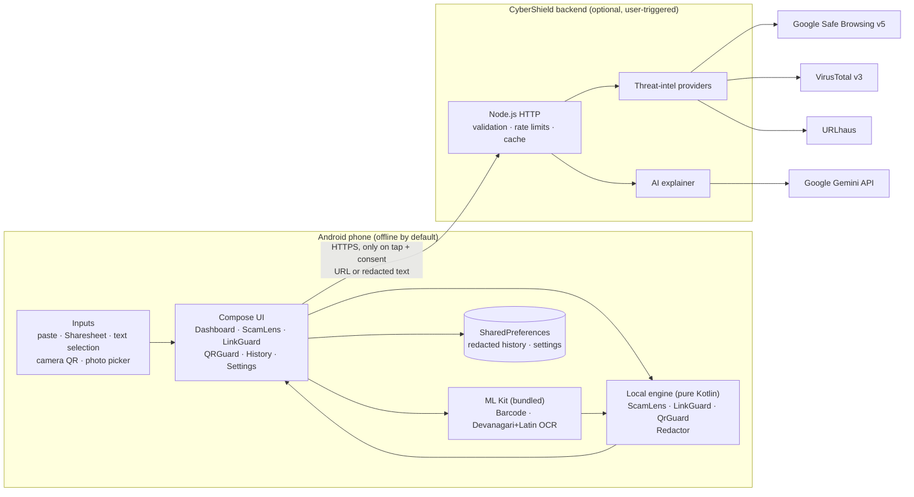
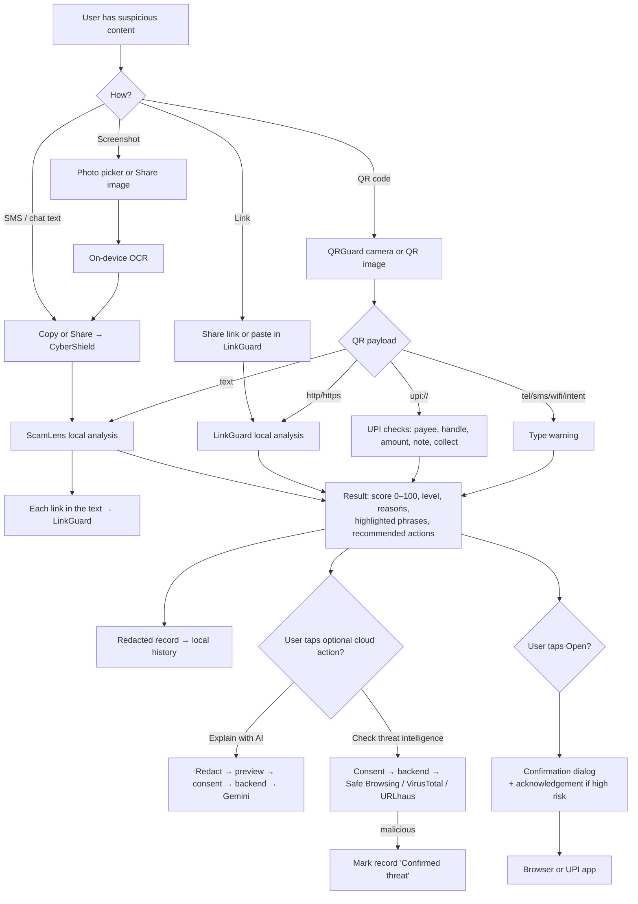
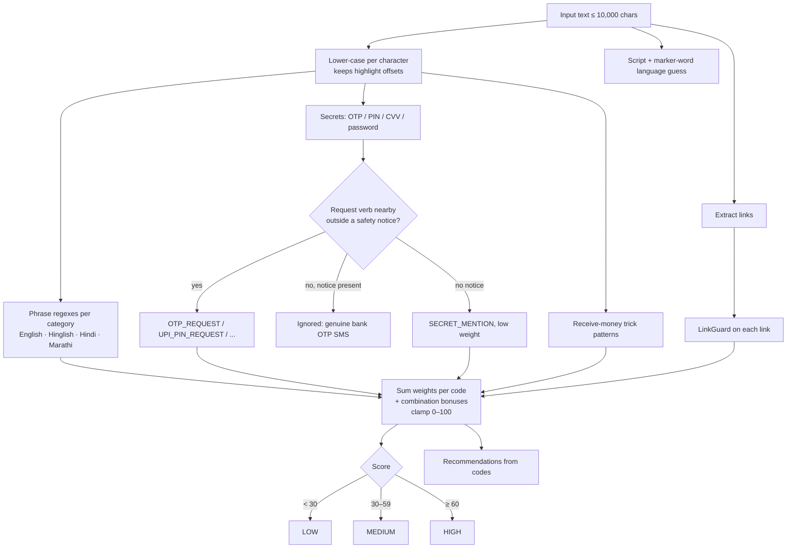
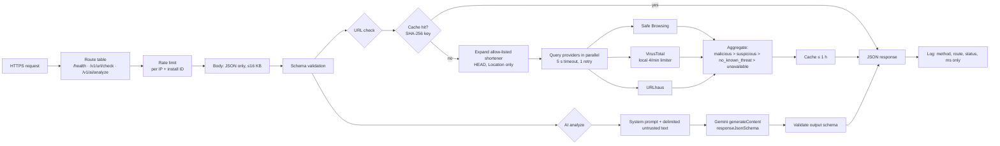

# Architecture

## System overview

API keys exist only in the backend's environment. The APK contains the backend's public URL and nothing else.

## Android modules (`android/app/src/main/java/io/cybershield/app`)

| Package | Responsibility | Android dependencies |
|---|---|---|
| `security/` | `ScamLens` (messages), `LinkGuard` (URLs), `QrGuard` (QR/UPI), `UrlParser` + `DomainTools`, `ScamPhrases` (EN/HI/MR dictionaries), `Redactor`, model types | **None**, so it runs in plain JVM unit tests |
| `data/` | `ScanHistoryRepository` (redacted records, search, stats) over a `HistoryStore`; `AppSettings` | `SharedPreferences` behind an interface |
| `cloud/` | `ReputationService` / `AiExplainer` interfaces, `BackendClient` implementation | `HttpURLConnection` behind a `Transport` interface |
| `vision/` | `ImageReaders`: OCR and QR decoding from a picked image | ML Kit |
| `ui/` | Compose screens, localized string mapping, confirmation dialogs, `openExternally` (http/https/upi only) | Compose, CameraX, AppCompat |
| `MainActivity` | Entry point; parses Sharesheet, `PROCESS_TEXT` and shortcut intents | AppCompat |

## Feature flow

## Threat-detection workflow (local engine)

LinkGuard parses URLs with its own parser (`java.net.URI` rejects many malicious inputs), converts hosts with IDNA, and checks: scheme, HTTPS, user-info, IP/numeric hosts, percent-encoded hosts, punycode, mixed scripts, brand keywords on non-brand domains, misspellings (edit distance plus confusable characters such as `rn`→`m` and Cyrillic `а`→`a`), shorteners, free-hosting suffixes, abused TLDs, subdomain depth, hyphens, ports, APK downloads, embedded redirect parameters and length. The registrable domain is approximated with a curated suffix list (including `co.in`, `gov.in`, `bank.in` and free-hosting platforms), not the full Public Suffix List.

## Backend architecture

## Key decisions

| Decision | Alternatives considered | Reason |
|---|---|---|
| Local rules first, cloud optional | Cloud-first classification | Works offline, no data leaves the phone by default, instant results |
| Rule engine rather than an on-device ML classifier | TFLite text model | No labelled Indian-language scam dataset was available to train or evaluate one honestly. Rules are explainable and testable. |
| Dependency-free Node backend | Express + middleware, Supabase | Few endpoints and no persistent data; zero dependencies means no supply-chain surface. Supabase adds a database that nothing needs. |
| SharedPreferences JSON for history | Room/SQLite | ≤200 small records; avoids an annotation processor. Revisit if history grows. |
| AppCompat per-app locales | Custom `Configuration` wrapping | Standard API, integrates with Android 13+ system language settings |
| Bundled ML Kit models + ABI splits | Play-services (unbundled) models | Works offline on first use and on sideloaded APKs; ABI splits keep the arm64 release APK ≈21 MB |
| No VirusTotal URL submission | Submit unknown URLs for scanning | Submissions are shared with VirusTotal's community, which could expose private links |
