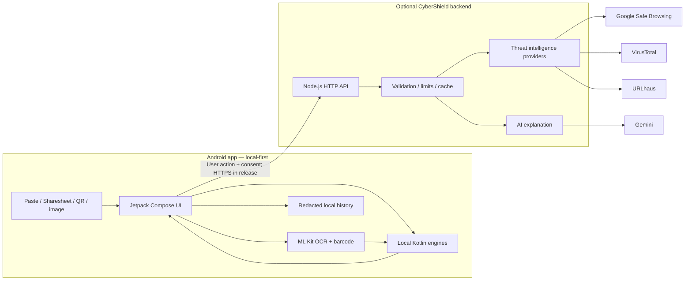

# CyberShield — Project Brief & Hackathon Master Document

> **Check first. Click with confidence.**  
> A privacy-first Android security assistant that helps people in India inspect suspicious messages, links, screenshots and QR-based payment requests before they act.

**Repository:** https://github.com/RajvardhanPatil07/CyberShield  
**Project status reviewed:** 4 November 2026  
**Reviewed branch:** `main`  
**Reviewed commit:** `91109e43228170686d8544efed1f130a76ef36fc`  
**Current app version:** `0.3.0`

---

## 1. Executive summary

CyberShield is an Android application designed to help everyday smartphone users recognise common digital-payment and social-engineering scams in India. A user can paste or share a suspicious message, inspect a URL without opening it, scan a QR code, or select a screenshot for on-device text recognition. CyberShield analyses the content and explains the risk signals in plain language.

The product is **on-device-first and privacy-first**. Its core detection engines run locally. Optional cloud features—URL threat-intelligence lookups and AI explanations—are user-triggered, require consent, and use a backend proxy so provider API keys are not embedded in the APK. The app does not silently monitor other apps, read all SMS, or initiate payments.

The core product is organised around three memorable tools:

- **ScamLens:** Is this message trying to manipulate me?
- **LinkGuard:** Is this link suspicious before I open it?
- **QRGuard:** Who or what is this QR code asking me to interact with or pay?

CyberShield is not positioned as a replacement for banks, UPI apps, antivirus products, or official cybercrime reporting. It is a practical decision-support layer that gives users an understandable warning at the moment they are deciding whether to trust a message, link, screenshot or QR code.

## 2. The problem

Digital scams often exploit ordinary communication and payment habits rather than sophisticated technical vulnerabilities. People receive messages or instructions that imitate banks, government departments, electricity providers, employers, customer support teams, delivery services or people they trust.

Examples include:

- Fake KYC updates and account-blocking threats.
- Requests to disclose an OTP, UPI PIN, CVV or password.
- Fraudulent collect requests disguised as cashback, refunds or receiving money.
- QR codes that lead to a payment request or an impersonating destination.
- Fake electricity-disconnection or parcel-delivery messages.
- Shortened or lookalike URLs that imitate trusted brands.
- Remote-access app installation instructions.
- Task-job, investment, loan and prize scams.
- “Digital arrest” and authority impersonation scripts.

The user is often forced to make a quick decision: click, scan, install, share a code, or approve a payment. Warnings are difficult to act on when they are technical, English-only, disconnected from the user's immediate context, or require sending private content to a remote service.

### The gap CyberShield addresses

CyberShield focuses on four connected gaps:

1. **Fragmented inspection:** messages, links, screenshots and QR codes are commonly checked using separate tools or informal advice.
2. **Low explainability:** a simple “dangerous” label does not teach the user what the scammer is trying to do.
3. **Privacy trade-offs:** some approaches ask for broad device permissions or upload content that users may consider private.
4. **Local context:** Indian payment flows, UPI collect requests, fake KYC scripts and Hindi/Marathi wording need to be considered in the analysis.

## 3. Our solution

CyberShield provides one user-controlled place to inspect suspicious content before taking action.

### The user journey

1. A user receives a suspicious SMS, chat message, URL, QR code or screenshot.
2. They paste it into CyberShield, share it from another app, choose an image, or open QRGuard.
3. The app runs local analysis first. Screenshot text is extracted on-device using ML Kit OCR.
4. CyberShield shows a risk score and level, the signals that contributed to it, highlighted phrases where supported, and safe next steps.
5. If the user wants more context, they may explicitly request a cloud threat-intelligence check for a URL or a redacted AI explanation.
6. Nothing opens automatically. The user must confirm before opening a URL or handing a UPI payment URI to a payment app. High-risk destinations require an additional acknowledgement.

### Product principle

**Warn, explain, and let the user decide.** CyberShield should never create a false sense of certainty, silently transmit private content, or take financial actions on the user's behalf.

## 4. Product modules

### 4.1 ScamLens — message and scam-language analysis

ScamLens analyses pasted or shared text for common social-engineering patterns. Its local rule engine covers categories such as:

- OTP, UPI PIN, CVV and password requests.
- Fake KYC and account suspension threats.
- Urgency, fear and authority impersonation.
- Cashback, refund, prize and reward lures.
- Receive-money tricks and suspicious payment instructions.
- Loan, fee, task-job and investment lures.
- Remote-access app and APK installation instructions.
- Digital-arrest language and secrecy pressure.

It highlights relevant phrases, calculates a 0–100 risk score, explains the signals, and provides safer next steps. The rules distinguish a message asking a user to reveal an OTP from a legitimate safety notice telling a user not to share an OTP.

**Inputs:** pasted text, shared text, text-selection action, and text extracted from a user-selected/shared screenshot.

### 4.2 LinkGuard — URL inspection

LinkGuard analyses a URL without opening the destination. Local checks include:

- HTTPS and scheme checks.
- IP-address and unusual host checks.
- Embedded user-info tricks.
- Punycode and mixed-script/homograph indicators.
- Brand impersonation and misspelling patterns.
- Suspicious subdomains, ports and hostname patterns.
- URL shorteners and selected free-hosting services.
- Suspicious TLD indicators.
- APK download paths and embedded redirect parameters.
- URL length and malformed input handling.

The registrable-domain logic uses a curated suffix list, not a complete Public Suffix List. A low score is not proof that a site is safe.

An optional, user-triggered backend lookup can query configured threat-intelligence providers. A provider match is distinguished from a local heuristic warning.

### 4.3 QRGuard — QR and UPI request inspection

QRGuard supports live camera scanning and QR decoding from a user-selected image. It classifies QR content and, for UPI payment URIs, extracts relevant fields such as payee, payee name, amount and note.

It looks for suspicious payment patterns, including collect requests, refund/prize language, impersonating payee names, unusual handles and amounts. It reinforces the critical user-safety rule:

**A UPI PIN is used to authorise sending money; it is not needed to receive money.**

CyberShield does not initiate a payment. UPI hand-off happens only after a confirmation flow, and the user's UPI application presents its own payment confirmation.

### 4.4 Screenshot OCR

A user can select or share a screenshot. ML Kit performs on-device OCR for Latin and Devanagari text; the extracted text is then analysed by ScamLens.

- Image selection is user initiated.
- The image is not automatically uploaded for OCR.
- Extracted content is handled by the local analysis path unless the user separately opts into a cloud explanation.
- OCR quality can vary with image quality, fonts, language mixing and layout.

### 4.5 Scan history and dashboard

The dashboard summarises scan activity, suspicious findings, high-risk results and recent events. History supports search, filtering and deletion.

History deliberately avoids storing full message bodies, complete URLs, UPI IDs or phone numbers. It stores limited scan metadata such as score, level, finding codes, time and limited destination hints.

### 4.6 Optional cloud intelligence and AI

The backend exposes two user-triggered capabilities:

- **URL reputation:** Google Safe Browsing v5, VirusTotal v3 report lookup and abuse.ch URLhaus.
- **AI explanation:** Gemini structured-JSON analysis for a plain-language explanation, scam type, red flags and safe steps.

The Android app talks to the CyberShield backend, not directly to provider APIs. Provider keys remain server-side. Requests are validated, bounded, rate-limited and time-limited. Provider failures are not treated as a “safe” result.

**Important current status:** provider integrations and response handling are implemented and covered by scripted tests, but the project documentation says they have not yet been verified against live API credentials. Do not present cloud threat intelligence or AI as live in a demo until keys are configured and real responses have been verified.

## 5. What makes CyberShield different

The differentiation is the combination and implementation choices—not a claim that no other product can scan a URL or detect a scam.

### 5.1 India-first threat context

CyberShield explicitly models UPI payment requests and common Indian scam narratives such as fake KYC, electricity-disconnection threats, receive-money tricks, digital-arrest impersonation and suspicious payment notes.

### 5.2 English, Hindi and Marathi focus

The app includes English, Hindi and Marathi interface resources and scam phrase dictionaries, including romanised Hindi patterns. Detection uses the language dictionaries together rather than requiring a perfect language choice first.

This is an initial multilingual scope, not a claim of complete coverage of all Indian languages or native-speaker-validated translations.

### 5.3 One workflow across messages, links, screenshots and QR codes

Instead of treating each suspicious item as an isolated category, CyberShield connects the input channels to a common explanation and safety workflow. A message can contain a link; a screenshot can become text for ScamLens; a QR code can contain a URL or a UPI payment URI.

### 5.4 Privacy by default

- Local analysis is the default.
- No SMS-reading permission.
- No notification-listener permission.
- No Accessibility Service.
- No contacts or location permission.
- No background surveillance of other apps.
- No private content in scan history by default.
- Cloud actions are optional and user-triggered, with redaction/consent for AI text.

### 5.5 Explainable and calibrated warnings

CyberShield shows why a result received its score. It separates heuristic signals from a provider-confirmed malicious listing. “No known threat” or a low heuristic score must not be described as proof of safety.

### 5.6 Responsible payment hand-off

CyberShield never pays, approves a collect request or automatically opens a destination. The user sees the decoded information and explicitly chooses whether to continue.

## 6. Intended users and use cases

### Primary users

- Everyday Android users who receive payment and account-related messages.
- UPI users who scan QR codes at shops, through messages or on posters.
- People who prefer Hindi or Marathi explanations.
- Families helping less technically confident relatives assess suspicious messages.
- Students, first-time smartphone users and small-business customers.

### Example use cases

| Situation | CyberShield flow | User benefit |
|---|---|---|
| “Your bank account will be blocked; update KYC” SMS | Share to ScamLens | Sees urgency/KYC signals and safer next steps |
| A link that resembles a bank domain | Paste into LinkGuard | Sees suspicious domain structure before opening |
| QR code claiming to provide cashback | Scan in QRGuard | Sees whether it is a payment URI and what it requests |
| Screenshot of a Hindi/English scam | Select/share screenshot | OCR extracts text on-device and ScamLens analyses it |
| Unsure why a message is suspicious | Read highlighted phrases; optionally request AI explanation | Understands the manipulation pattern |

## 7. System architecture

### High-level architecture

### Android application

- Kotlin 2.0 and Jetpack Compose / Material 3.
- Android Gradle Plugin 8.7.3.
- Compile/target SDK 35; minimum SDK 26 (Android 8.0).
- CameraX for live camera preview and QR scanning.
- ML Kit barcode scanning and bundled Devanagari/Latin OCR.
- AppCompat per-app language support.
- SharedPreferences-backed redacted history and settings.
- Pure Kotlin security logic separated from Android UI for JVM testing.

### Backend

- Node.js 22.9 or newer.
- Dependency-free Node.js HTTP service.
- `/health`, `/v1/url/check`, and `/v1/ai/analyze` endpoints.
- Input validation, JSON-only request handling, body-size limits, per-IP/per-install rate limits, timeouts, retries, provider isolation and hashed TTL caching.
- Fixed provider hosts and allow-listed shortener expansion to reduce SSRF exposure.
- No database: the backend is stateless apart from in-memory cache and rate-limit state.

### Main code areas

| Path | Responsibility |
|---|---|
| `android/app/src/main/java/.../security/` | ScamLens, LinkGuard, QRGuard, URL/domain tools, phrase dictionaries, redaction and models |
| `android/app/src/main/java/.../vision/` | OCR and QR decoding from images |
| `android/app/src/main/java/.../cloud/` | Backend client and cloud service interfaces |
| `android/app/src/main/java/.../data/` | History and settings |
| `android/app/src/main/java/.../ui/` | Compose screens and user flows |
| `backend/src/` | HTTP API, providers, AI, validation, URL expansion and support utilities |
| `docs/` | Architecture, pitch, demo, security review, release and limitations |
| `.github/workflows/android-build.yml` | CI tests, lint and APK builds |

More detailed diagrams and design decisions: [docs/ARCHITECTURE.md](ARCHITECTURE.md).

## 8. Privacy and security model

CyberShield uses a least-permission approach.

### Permissions

| Permission | Purpose |
|---|---|
| Camera | Live QR scanning, requested when the user opens QRGuard |
| Internet | Optional user-triggered cloud features |

The app does not request SMS, contacts, location, notification-listener, Accessibility Service, phone or broad storage permissions.

### Data handling

- Local message and URL analysis happens on the device.
- Scan history stores limited metadata rather than message contents.
- History and settings are excluded from Android backup and device-to-device transfer according to the project configuration.
- AI text is redacted and previewed before explicit consent.
- API keys are held in backend environment variables.
- Release networking is HTTPS-only.
- No automatic link opening or payment initiation.

**Telemetry disclosure:** the README and privacy policy disclose that bundled ML Kit may send diagnostic telemetry such as device/app/performance information. Do not claim that absolutely no device-related data ever leaves the device.

### Platform boundary

Android's application sandbox isolates app data and processes. A normal third-party app cannot simply read another app's private data. CyberShield therefore uses explicit sharing, text selection, user-selected images and permissioned camera access rather than claiming it can silently inspect every private chat or notification. See the [Android Application Sandbox documentation](https://source.android.com/docs/security/app-sandbox).

### Documents

- [Privacy policy](../PRIVACY.md)
- [Security review](SECURITY_REVIEW.md)
- [Platform limitations](PLATFORM_LIMITATIONS.md)

## 9. Current implementation and verification status

This section is deliberately conservative and reflects the repository and CI state reviewed on 4 November 2026.

| Area | Status | Evidence / qualification |
|---|---|---|
| Android app build | **CI passed** | Latest reviewed GitHub Actions run succeeded |
| Android JVM unit tests | **CI passed** | README reports 62 tests |
| Android lint | **CI passed** | README/security review report 0 lint issues |
| Debug APK | **Built and uploaded** | CI artifact available |
| Release APK | **Built and uploaded unsigned** | No signing keystore configured in CI |
| Backend tests | **CI passed** | README/backend docs report 19 tests |
| ScamLens | **Implemented** | Local rules, explanations, EN/HI/MR dictionaries; emulator and test coverage documented |
| LinkGuard | **Implemented** | Local URL heuristics and optional backend client |
| QRGuard | **Implemented; device validation pending** | Image QR tests documented; live camera behaviour needs physical-device testing |
| Screenshot OCR | **Implemented** | On-device OCR; emulator test documented |
| History/dashboard/settings | **Implemented** | Search, filters, deletion, stats and language settings |
| Text sharing | **Implemented and tested** | Instrumented flows documented |
| Image sharing | **Partially verified** | Code exists; end-to-end sharing from real third-party apps still needs device validation |
| Threat intelligence | **Integration implemented; live credentials pending** | Scripted provider tests; not verified against live keys |
| AI explanation | **Integration implemented; live credentials pending** | Scripted backend tests; not verified against live Gemini key |
| Multilingual | **Implemented to documented scope** | English/Hindi/Marathi; native-speaker review pending |
| Physical Android devices | **Not yet verified** | Project docs state Android 15 emulator testing only |
| Accuracy on real-world dataset | **Not measured** | No published precision/recall yet |
| Release signing | **Not configured** | Release artifact is unsigned |

### CI evidence

Latest reviewed run:

- [GitHub Actions run #16 — successful](https://github.com/RajvardhanPatil07/CyberShield/actions/runs/41879972009)
- Commit: `91109e43228170686d8544efed1f130a76ef36fc`
- Android tests, lint, debug APK build and release APK build: successful.
- Backend syntax check and tests: successful.
- Artifacts uploaded: `cybershield-debug-apk`, `cybershield-release-apk`, and `reports`.

The CI workflow does not itself prove real-world detection accuracy or physical-device camera behaviour. The nine instrumented tests are present/documented, but the current workflow steps reviewed run JVM tests, lint and APK assembly—not `connectedDebugAndroidTest`.

## 10. Known limitations and risks

Be transparent about these in the presentation and judging Q&A.

1. **Detection accuracy:** The local detector is rule-based. Precision and recall have not been measured on a labelled, representative dataset. New scam wording can be missed; legitimate content can trigger a warning.
2. **Live provider credentials:** Safe Browsing, VirusTotal, URLhaus and Gemini integrations need valid provider keys and live verification. Scripted tests are not equivalent to live service validation.
3. **Physical-device testing:** Real camera QR scanning, app-to-app hand-off, real WhatsApp/Messages sharing, and OCR on varied screenshots need testing on physical Android phones.
4. **Language validation:** Hindi and Marathi need native-speaker review; language detection is a best-effort guess. More Indian languages are future work.
5. **No background surveillance:** The app does not read all other apps' messages or notifications. This is an intentional privacy and platform decision.
6. **Backend abuse resistance:** The backend has no app attestation yet; in-memory rate limits are per instance and are not a horizontally shared limit.
7. **Release signing:** Release APKs are unsigned until a keystore and CI secrets are configured.
8. **Domain suffix approximation:** Local registrable-domain checks use a curated suffix list rather than the full Public Suffix List.

## 11. Technology stack

| Layer | Technology |
|---|---|
| Android language | Kotlin |
| UI | Jetpack Compose, Material 3 |
| Android build | Gradle wrapper, AGP 8.7.3, JDK 17 |
| Camera / QR | CameraX, Google ML Kit Barcode Scanning |
| OCR | Google ML Kit Text Recognition for Devanagari/Latin |
| Local detection | Pure Kotlin rule-based engines |
| Local state | SharedPreferences-backed repositories |
| Backend | Node.js 22.9+, built-in modules, no npm dependencies |
| Threat intelligence | Google Safe Browsing v5, VirusTotal v3 report lookup, abuse.ch URLhaus |
| AI | Gemini API with structured JSON response validation |
| Testing | JUnit, AndroidX instrumented tests, Node.js `node:test` |
| CI | GitHub Actions |

## 12. Demo plan (3–4 minutes)

A strong demo should tell one connected story rather than showing every menu.

### Suggested sequence

1. **Opening (20 seconds):** “A scam often succeeds in the few seconds between receiving a message and acting on it. CyberShield gives users a way to check first.”
2. **ScamLens (40 seconds):** Share or paste a fake KYC/account-blocking message. Show highlighted red flags, risk score and safe next steps.
3. **LinkGuard (40 seconds):** Inspect a lookalike bank URL. Show domain impersonation signals without opening the link.
4. **QRGuard (45 seconds):** Scan the demo UPI collect/payment QR. Explain the payee, amount and why a PIN should never be entered to receive money. Do not complete a payment.
5. **Screenshot OCR (30 seconds):** Select the sample Hindi/English scam screenshot and show the on-device OCR result.
6. **Privacy (30 seconds):** Show settings/history and explain that the local engine works without cloud calls and that history does not keep message text or full URLs.
7. **Cloud (optional, 30 seconds):** Only demonstrate live threat intelligence or AI if valid credentials are configured and a live provider response has been verified. Otherwise state clearly that the backend integration is implemented and the demo uses scripted provider responses.
8. **Close (15 seconds):** “CyberShield does not make decisions or payments for users. It makes the warning understandable before they act.”

Use the sample images and demo instructions in [docs/DEMO.md](DEMO.md) and [docs/demo/](demo/).

## 13. Project impact and evaluation plan

Do not invent impact numbers. Measure the project with a labelled evaluation set and usability testing.

### Technical evaluation

- Precision, recall and F1 by scam category.
- False-positive rate on legitimate bank/security messages.
- False-negative rate for high-risk UPI and credential theft patterns.
- URL heuristic performance on benign and malicious examples.
- OCR character/word error rate on English, Hindi and mixed-language screenshots.
- Detection latency on low-, mid- and high-range Android devices.
- Offline functionality and crash-free session rate.

### User evaluation

Run a small, consent-based pilot with users who read English, Hindi and Marathi.

Measure:
- Whether users understand the risk explanation.
- Whether users correctly identify “send money” vs “receive money” UPI flows.
- Whether users know what to do after a warning.
- False alarm fatigue and trust calibration.
- Completion time for message, URL and QR checks.

Publish sample size, methodology and limitations alongside any results.

## 14. Roadmap

### Priority 1 — Field validation

- Test on multiple physical Android devices and Android versions.
- Verify live camera QR scanning and UPI app hand-off.
- Test text and image sharing from common messaging apps.
- Verify OCR with real-world English, Hindi and Marathi screenshots.
- Fix device-specific defects.

### Priority 2 — Live intelligence

- Configure provider credentials securely.
- Deploy backend to an HTTPS endpoint.
- Verify Safe Browsing, VirusTotal and URLhaus against documented test cases.
- Verify Gemini structured output and redaction behaviour.
- Add operational monitoring without logging sensitive user content.
- Respect each provider's free-tier, non-commercial and data-sharing terms.

### Priority 3 — Detection quality

- Build a labelled dataset from public advisories and carefully curated examples.
- Include benign bank alerts and genuine OTP safety notices.
- Publish precision/recall and false-positive analysis.
- Expand phrase dictionaries with native-speaker review.

### Priority 4 — Production hardening

- Add Play Integrity or an appropriate app-attestation mechanism.
- Replace per-instance in-memory limits if deploying multiple backend instances.
- Configure secure release signing and key rotation.
- Conduct independent security review and accessibility testing.
- Decide on an open-source licence after reviewing dependency and provider terms.

## 15. Hackathon positioning

### One-line description

**CyberShield is a privacy-first Android scam-prevention assistant that checks messages, links, screenshots and UPI QR codes in English, Hindi and Marathi—before users click, scan or pay.**

### 30-second pitch

“Most digital-payment scams do not begin with a hack. They begin with a convincing message, a fake KYC link or a QR code that pressures someone to act quickly. CyberShield helps users pause before that action. ScamLens analyses suspicious messages, LinkGuard inspects URLs without opening them, and QRGuard explains UPI QR payment requests. Screenshot OCR works on-device, and the app supports English, Hindi and Marathi. The local engine works offline; optional threat intelligence and AI are only used when the user chooses. We designed it to explain the warning while keeping user privacy and control at the centre.”

### 100-word abstract

CyberShield is a privacy-first Android application designed to reduce exposure to digital-payment fraud and social engineering in India. It brings together three user-facing tools: ScamLens for suspicious messages, LinkGuard for URL inspection, and QRGuard for QR and UPI payment-request analysis. Users can also select screenshots for on-device OCR. The local detection engine recognises common patterns such as fake KYC, OTP/UPI PIN theft, payment collect tricks, impersonation and suspicious links, and explains its findings in English, Hindi and Marathi. Optional cloud threat intelligence and AI explanations are user-triggered and routed through a backend that keeps provider credentials off-device.

### What judges should remember

1. **India-specific:** UPI payment semantics and locally relevant scam narratives.
2. **Privacy-first:** local analysis, limited permissions, user-triggered cloud actions.
3. **Explainable:** reasons and safe actions, not just a black-box danger label.
4. **Multi-input:** messages, URLs, screenshots and QR codes in one workflow.
5. **Honest engineering:** clear distinction between heuristic, provider-confirmed, scripted-demo and live-verified results.

## 16. Frequently asked questions

**Does CyberShield automatically read WhatsApp or SMS?**  
No. Users paste or share content, use the text-selection action, or select a screenshot. The app does not request SMS or notification access and does not claim to inspect every private conversation.

**Does it work offline?**  
The local message, URL and QR analysis paths are designed to work on-device. Cloud threat intelligence and AI explanation require network access and a configured backend.

**Does it guarantee a website is safe?**  
No. A low heuristic score or “no known threat” result is not a safety guarantee. Threat feeds can be incomplete or delayed.

**Does CyberShield make UPI payments?**  
No. It decodes and explains payment QR information. It never initiates a payment or enters a PIN.

**Are the AI and threat-intelligence integrations live?**  
They are implemented in the code and tested with scripted upstream responses. Live provider verification requires credentials and a deployed backend.

**Why not monitor all notifications in the background?**  
The project intentionally avoids broad surveillance permissions. Android's app sandbox and permission model limit access to other apps' private data. CyberShield uses explicit user-controlled sharing and selection instead.

**Is the release APK ready for public distribution?**  
CI builds the release APK, but it is unsigned until release signing credentials are configured. Physical-device validation and live provider verification also remain before a production launch.

## 17. Setup and useful repository links

- [Repository](https://github.com/RajvardhanPatil07/CyberShield)
- [README](../README.md)
- [Architecture](ARCHITECTURE.md)
- [Demo instructions](DEMO.md)
- [Pitch summary](PITCH.md)
- [Security review](SECURITY_REVIEW.md)
- [Privacy policy](../PRIVACY.md)
- [Platform limitations](PLATFORM_LIMITATIONS.md)
- [Multilingual scope](MULTILINGUAL.md)
- [Release and signing](RELEASE.md)
- [Backend setup](../backend/README.md)
- [GitHub Actions](https://github.com/RajvardhanPatil07/CyberShield/actions)
- [Latest successful CI run](https://github.com/RajvardhanPatil07/CyberShield/actions/runs/41879972009)

### Backend environment variables

See [backend/.env.example](../backend/.env.example). The optional provider keys are:

- `GOOGLE_SAFE_BROWSING_API_KEY`
- `VIRUSTOTAL_API_KEY`
- `URLHAUS_AUTH_KEY`
- `GEMINI_API_KEY`
- `GEMINI_MODEL`

Never commit real keys or a production `.env` file. Review provider terms before using free tiers in a public or commercial product. In particular, the current backend documentation describes non-commercial restrictions for the Google Safe Browsing and VirusTotal free/public APIs.

## 18. Submission checklist

- [ ] Confirm whether the repository should be made public for judges. The repository was marked private at the time of this review.
- [ ] Test the latest debug APK on at least one physical Android phone.
- [ ] Test live camera QR scanning and UPI chooser hand-off.
- [ ] Test real app-to-app text and image sharing.
- [ ] Configure and verify live threat-intelligence credentials, or clearly demo without claiming live results.
- [ ] Configure and verify Gemini, or clearly label AI output as scripted.
- [ ] Review Hindi and Marathi strings with native speakers.
- [ ] Configure release signing if distributing a signed release APK.
- [ ] Prepare a stable demo device, screenshots and offline fallback.
- [ ] Keep the pitch and README aligned with the actual tested status.
- [ ] Do not publish unsupported accuracy, user-count or impact claims.

---

**Final positioning:** CyberShield is a substantial Android MVP with a local-first detection workflow, QR/UPI analysis, screenshot OCR, multilingual support, optional cloud integrations, a backend security layer, automated tests and successful CI builds. It is suitable for a technical hackathon demonstration after physical-device checks. It should not yet be described as a production-proven fraud-prevention system: real-world detection accuracy, live provider verification, physical-device validation and release signing remain important gates.
